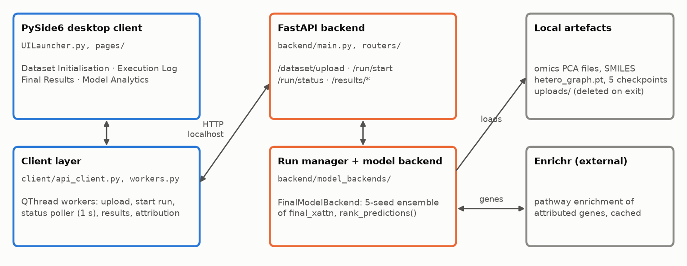
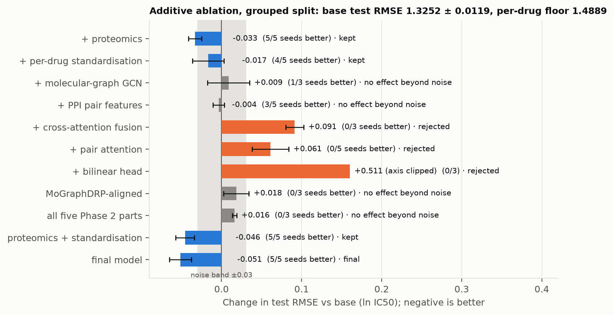
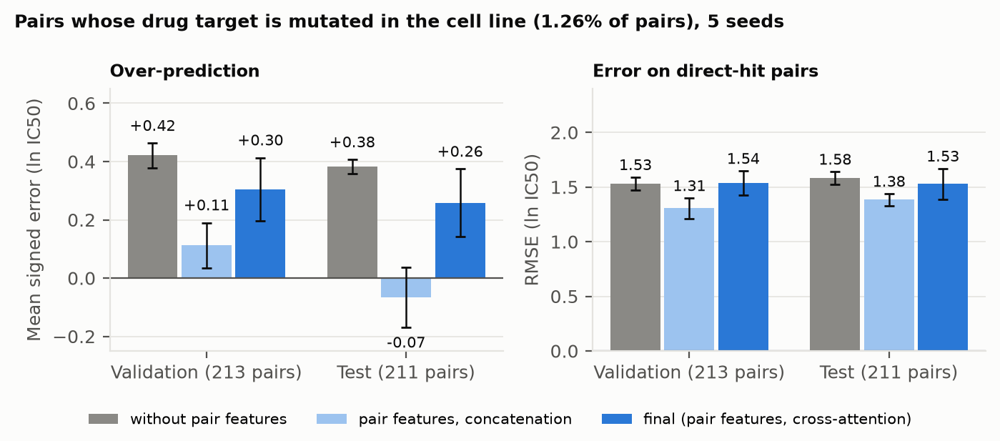
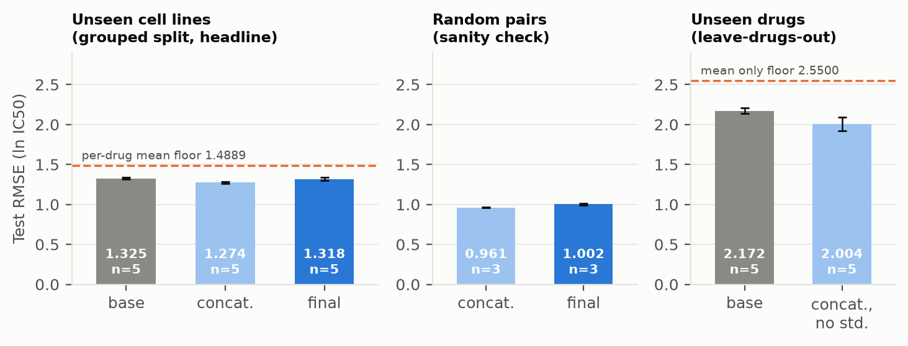
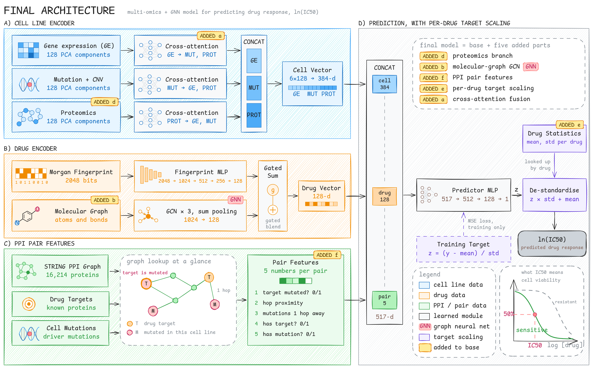
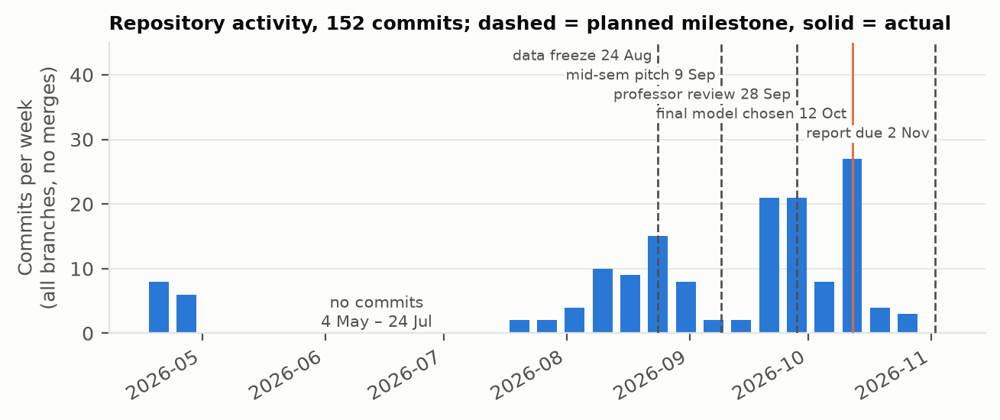

# GNN-Based Multi-Omics Integration for Predicting Cancer Drug Response

**Final Project Report** · FIT3162 Computer Science Project 2 · Team MCS16
Supervisor: Dr Ong Huey Fang · Submitted 2 November 2026

**Word count:** [fill in from Google Docs, sections 1–6 only; target ≤ 3,500]

## Team members

| Initials | Name | Student ID |
|---|---|---|
| AA | Aditya Ansh | 33520070 |
| CC | Charmaine Chee | 33520399 |
| WH | Wasif Hussain | 33621837 |
| SM | Shaahid Marikar | 34086242 |

## Authorship statement

> **PROPOSED, for the team to confirm or change before submission. A missing statement costs 50%.** Each member drafted the sections listed and edited and finalised other members' contributions to them.

- **AA (Aditya Ansh)** led Section 3.2 (Results), Section 3.4 (Key decisions) and Sections 4.2–4.4 (Data pipeline, Training, Evaluation protocol). AA prepared Figures 2, 3, 4 and 6 from the result files, Table 3 (data pipeline) and Table D1 (Appendix D).
- **CC (Charmaine Chee)** led Section 2.2 (Related work), Section 4.1 (Design rationale) and Section 3.5 (Limitations and future work). CC prepared Figure 5 (final architecture) and the reference list, and was the document's proof editor.
- **SM (Shaahid Marikar)** led Section 1 (Introduction), Section 3.1 (Delivered product), Section 3.3 (Requirements) and Sections 4.5–4.6 (Software, tools and application architecture). SM prepared Figure 1, Table A1 (RTM), the screenshots in Appendix B and the sample code in Appendix C.
- **WH (Wasif Hussain)** led Section 2.1 (Context), Section 5 (Critique) and Section 6 (Conclusion). WH prepared Table 5 (proposal against outcome), the front matter and the word count.

Google Doc (edit log): [link]

## Table of contents

[Insert automatically in Google Docs: Insert → Table of contents.]

**Figures:**
1. Application architecture
2. Additive ablation ladder
3. Direct-hit pairs
4. Three evaluation protocols
5. Final model architecture
6. Repository activity against milestones

Appendix figures: B1–B6, application screenshots (Appendix B).

**Tables:**
1. Main results
2. Requirements summary
3. Data pipeline
4. Tools
5. Proposal against outcome

Appendix tables: A1 (RTM), D1 (full ablation).

---

## 1. Introduction

Patients with the same cancer diagnosis often respond differently to the same drug, and matching treatment to a tumour's molecular profile improves outcomes: across 570 phase II trials, biomarker-matched therapy achieved a 31% response rate against 10.5% without matching (Schwaederle et al., 2015). Computational drug-response prediction (DRP) estimates a drug's potency, measured as the half-maximal inhibitory concentration (IC50), from a tumour's molecular data and the drug's structure.

This project set out to predict ln(IC50) for cancer cell lines from drug structure and three omics layers: gene expression (GE), mutation and copy-number variation (Mut+CNV), and proteomics. Predictions are delivered through a local desktop application for cancer pharmacology researchers and bioinformaticians. The proposal planned a graph attention network with cross-attention fusion that would improve on the published MoGraphDRP model (Ahmadi et al., 2026).

The project delivered a desktop application that ranks GDSC2 drugs by predicted IC50 for a selected cell line, and a model for cell lines not seen in training. The final model reaches a test RMSE of 1.2737 on ln(IC50), against 1.3252 for our reproduction of the MoGraphDRP architecture and 1.4889 for a baseline that predicts each drug's mean. Every added component was evaluated in an additive ablation over five random seeds, and several components named in the proposal were dropped because they did not improve accuracy.

Section 2 summarises the background and related work. Section 3 presents the delivered product, the results, the requirements and the main decisions. Section 4 describes the method in enough detail to reproduce it. Section 5 critiques the project and how it was managed, and Section 6 concludes.

## 2. Project background

### 2.1 Context

Precision oncology depends on reading a tumour's molecular profile, yet this information is under-used. In a 2026 cohort of 63,294 US patients with advanced cancer, many never received genomic testing (Hage Chehade et al., 2026), and clinicians face more multi-omics data than one person can integrate (Aldea et al., 2023). Public pharmacogenomic screens make the computational problem tractable: GDSC2 measures drug response across about a thousand cancer cell lines (Yang et al., 2013), and the Cell Model Passports provide matched omics profiles (van der Meer et al., 2019). A model trained on these screens can rank candidate drugs for a cell line before costly wet-lab assays, which is the use case the application supports; clinical use on patients is out of scope.

### 2.2 Related work, updated since the proposal

The proposal reviewed flat-vector baselines such as random forests, deep multi-omics models that concatenate features (Wang et al., 2021; Li et al., 2026) and graph-based models (Peng et al., 2022), and adopted MoGraphDRP as the benchmark. MoGraphDRP combines multi-omics with a drug fingerprint and molecular graph through bilinear attention and reports an RMSE of 0.6622 on GDSC (Ahmadi et al., 2026).

Three findings changed how this literature applies to our work. First, MoGraphDRP is evaluated on a random split of drug–cell-line pairs, so its test cell lines also appear in training, which flatters its error (Section 3.4). Second, MIDI (Wanyan et al., 2025), which the proposal did not cite, already combines drug-target knowledge with attention over genes, splits by cell line, and compares cell lines with and without a mutated target, so none of these is claimed as new here. Our pair features differ in taking a drug's known targets as explicit inputs, being computed per drug–cell-line pair, and using the topology of the STRING protein–protein interaction (PPI) network (Szklarczyk et al., 2023). Third, a graph attention network (GAT; Veličković et al., 2018) performed worse than graph convolution on our data (Section 3.4).

The contribution is therefore narrower than the proposal described, but better supported: a cell-line-grouped, multi-seed, additive ablation of a reproduced published model, extended with proteomics and a biological pair prior.

## 3. Outcomes

### 3.1 The delivered product

The main deliverable is a desktop application: a PySide6 client communicating with a local FastAPI backend (Figure 1; screenshots in Appendix B). The user uploads a drug-response file and selects a cell line (Figure B1), then follows the run through a live log and progress view (Figure B2). The results page ranks the drugs by predicted IC50 in micromolar, with a sensitivity band (high below 1 µM, medium below 10 µM) and a confidence score for each, and results can be downloaded as CSV or exported as a report (Figure B3). For a selected drug, the page lists the drug's target genes and the cell line's driver-mutated genes with the change in prediction when each is removed (Figure B4), and retrieves pathway enrichment from Enrichr (Kuleshov et al., 2016) when at least five genes are listed (Figure B5). An analytics page compares predicted and measured validation values (Figure B6). The uploaded file is deleted when the application closes.

The application serves the final model (Section 3.2) by averaging the predictions of its five trained seeds, so nothing is retrained at run time. Individually the seeds score a test RMSE of 1.248 to 1.280; their average scores 1.2377 (validation 1.2118). Each seed reproduces its recorded validation RMSE when loaded, confirming that the application rebuilds the model's inputs exactly. The final model replaced an earlier heterogeneous graph neural network, HeteroIC50GNN (test RMSE 1.3301), around which the application was first built.

The second deliverable is the framework that produced the final model: `run_ablation.py` trains any combination of components on a frozen base model with fixed settings, one switch per component, and records one row per run.



*Figure 1. Application architecture. Blue: client; orange: backend; grey: local artefacts and the one external service.*

### 3.2 Results

All results use the grouped split, in which test cell lines are never seen in training, and are reported as mean ± standard deviation over seeds. The per-drug-mean baseline (RMSE 1.4889) predicts each drug's average training response; since drug identity alone explains 71.5% of the variance in ln(IC50), a model must beat it to show that it uses the omics data at all. Training the same model with different seeds changes RMSE by up to about 0.03, and differences inside this noise band are not treated as real effects.

*Table 1. Main results, test fold, grouped split.*

| Configuration | Seeds | Validation RMSE | Test RMSE | Δ test vs base |
|---|---|---|---|---|
| Per-drug mean (floor) | – | – | 1.4889 | +0.1637 |
| Base (MoGraphDRP-style, reproduced) | 5 | 1.2961 ± 0.0059 | 1.3252 ± 0.0119 | 0 |
| + proteomics | 5 | 1.2796 ± 0.0060 | 1.2920 ± 0.0125 | −0.0331 |
| + per-drug standardisation | 5 | 1.2599 ± 0.0074 | 1.3086 ± 0.0144 | −0.0166 |
| + both | 5 | 1.2454 ± 0.0037 | 1.2797 ± 0.0192 | −0.0455 |
| **Final model** (+ both + molecular graph + pair features) | 5 | **1.2441 ± 0.0102** | **1.2737 ± 0.0144** | **−0.0514** |

The final model outperforms the base model on all five seeds, with a Pearson correlation of 0.892 and an R² of 0.787 (3,644,525 parameters; about 20 minutes of training on a 4 GB GPU). Figure 2 shows every configuration tested. The improvement comes from proteomics and from per-drug standardisation of the training target, each kept because it improved validation RMSE on all five seeds; their effects are close to additive. Cross-attention fusion (+0.091) and the pair-attention module (+0.061) made the model worse, and MoGraphDRP's bilinear head trained unstably without the molecular graph, so all three were rejected. The molecular-graph GCN (Kipf & Welling, 2017) and the PPI pair features did not change all-pairs RMSE beyond the noise band.



*Figure 2. Change in test RMSE against the base model, paired by seed. Error bars are the standard deviation of the per-seed differences. Verdicts follow the validation rule (Section 4.4).*

Because the project objectives require a graph component, the team decided on 11 October that the final model must contain one. Under the selection rule, a graph-bearing configuration was eligible if its validation RMSE was within 0.03 of the best so far (1.2454), and the eligible one with the lowest validation RMSE was chosen. Of three eligible configurations, the one adding both the molecular graph and the pair features won.

The pair features matter for a small group of pairs. In 1.26% of pairs the drug's own target protein is mutated in the cell line (direct hits), and without the pair features every model over-predicted ln(IC50) on these pairs by about 0.4, predicting the cell lines to be more resistant than they were. The pair features remove this bias and reduce direct-hit RMSE on all five seeds on both validation and test (Figure 3).



*Figure 3. Signed error and RMSE on direct-hit pairs, with and without the pair features.*

We also tested whether the trained model uses this signal in the direction the measurements support, comparing it with 50 untrained copies of the model. All three tests passed:
- Removing the hit raised direct-hit RMSE on every seed (test, from 1.410 to 1.643).
- Across 30 drugs, the model's per-drug effect correlated with the measured effect (Spearman +0.725 ± 0.049, against +0.034 for untrained models, none of which reached the trained mean).
- On 44 held-out BRAF-mutant cell lines treated with BRAF inhibitors, the effect tracked measured sensitivity (Spearman +0.633 ± 0.026; 0 of 50 untrained models).

This is a sensitivity analysis of five inputs and does not explain predictions at the level of individual genes.

Under two other protocols (Figure 4), the final model scores 0.9622 against 1.0162 for the base model on a random split of pairs, although per-drug standardisation alone does better there (0.9423). On held-out drugs, the model without standardisation scores 2.0038 ± 0.0843 against 2.1722 ± 0.0369, but the interval over the 36 held-out drugs includes zero, so no improvement on new compounds is claimed.



*Figure 4. The base model against the final model under the three protocols. The leave-drugs-out arm cannot use per-drug standardisation, because new drugs have no training statistics.*

### 3.3 Requirements

All seven requirements in the Requirements Traceability Matrix are met (Table 2; the full matrix with evidence is in Appendix A).

*Table 2. Requirement status at the end of the project.*

| ID | Requirement (abridged) | Status | Where it is met |
|---|---|---|---|
| R01 | Ranked IC50 predictions with a reliability measure | Met | Results table ranked by IC50 with a confidence score (Figure B3) |
| R02 | Uploaded files deleted after the session | Met | Upload kept apart from training data, deleted on exit (Appendix A) |
| R03 | Real-time progress feedback | Met | Live log and backend-driven progress (Figure B2) |
| R04 | Molecular profile summary of top mutations | Met | Driver-mutated genes and drug targets with their effect on the prediction (Figure B4) |
| R05 | Export of results | Met | CSV download and report export (Figure B3) |
| R06 | Multi-omics input and SMILES-derived drug structure | Met | GE, Mut+CNV and proteomics; Morgan fingerprint and molecular graph from SMILES |
| R07 | Runs locally in 4–8 GB of VRAM | Met | All training and inference on a 4 GB GTX 1650 |

Two requirements are met in a different form from the proposal's wording. For R01, the reliability measure is a confidence score based on how much the five seeds disagree about a drug (a deep ensemble; Lakshminarayanan et al., 2017), scaled by the ensemble's validation error; it is not a calibrated interval. For R06, the omics layers are concatenated, because the ablation rejected cross-attention (Section 3.4).

### 3.4 Key decisions and their justification

The grouped split was adopted as the headline protocol because it reflects the intended use: predicting response for a cell line the model has not seen. The same model scored 0.8971 under a random split and 1.2442 under the grouped split, a difference that accounts for about 60% of the gap to MoGraphDRP's published 0.6622. Results are therefore compared only with our own reproduction of MoGraphDRP.

The GAT was dropped after reaching a test RMSE of 2.25 on our heterogeneous graph, against 1.35 for graph convolution. The only graph neural network in the final model is the GCN over the drug's molecular graph, retained because the project requires a graph component despite its negligible measured effect.

Cross-attention fusion was rejected for a structural as well as a numerical reason: with one vector per omics layer every attention weight equals one, so the module reduces to extra projection layers, which increased RMSE by 0.091.

The pair-attention module, the project's original novelty, let a drug's target proteins attend to a cell line's mutated proteins. With only about 1.6 matching pairs per training batch, its attention stayed close to uniform (a mutated target received 0.15–0.17 of its weight against 0.13–0.15 by chance), and it overfitted early and worsened every subset of pairs. This rejects the module as built rather than the underlying idea. PPI message passing on top of it was not attempted, since it would have depended on an attention layer that had not learned.

### 3.5 Limitations and future work

The application can name few genes. Because the omics layers enter the final model as principal components, the only genes it sees individually are a drug's targets and a cell line's driver mutations. About a third of pairs have no gene list, mostly because the drug has no known target, and most others list one to four genes, so pathway enrichment, which needs five, runs for only about 4% of pairs. HeteroIC50GNN scored every protein and always had enough genes, but was less accurate.

Conformal prediction could turn the confidence score into the calibrated interval the requirement originally described. The model is validated for unseen cell lines only, and no configuration passes messages over the PPI network, which enters only through precomputed features. The proposal's SHAP module was replaced by the sensitivity test in Section 3.2, which covers 1.26% of pairs and names no gene beyond a drug's annotated target.

Two data issues remain. The principal component analysis (PCA) for each omics layer was fitted on all 532 cell lines, including test lines; the leak is unsupervised, but a strict pipeline would fit it on training lines only. In addition, about 919 cell lines have all three omics layers, yet the processed matrices contain 532, for reasons not documented. The proposal's low-priority items (an interactive PPI subgraph view, container packaging and sub-second latency) were not pursued. Future work could add a cell-line growth-rate covariate, which explains part of the remaining error and awaits supervisor approval, and an automated test suite.

## 4. Methodology

### 4.1 Design rationale

Because the planned design changed several times, the final model was built as a frozen base with switchable components, so that each change could be measured separately (Figure 5). The base reproduces MoGraphDRP's architecture from its public code: per-omics MLP branches, a fingerprint encoder and a predictor MLP. As a check, the full MoGraphDRP-aligned variant scored 0.978 ± 0.002 under a random split, against the published 0.9497 without its XGBoost stage; the remaining gap is attributed to data differences. The base was then frozen, and each component implemented as a flag on it. The final model concatenates three 128-dimensional cell-line branches (GE, Mut+CNV and proteomics), a 128-dimensional drug vector that blends the Morgan fingerprint and molecular-graph GCN through a learned gate, and the five PPI pair features, and passes them through the predictor MLP.



*Figure 5. The final model. Components added to the base are labelled.*

### 4.2 Data pipeline

The data pipeline consists of scripts in `src/data/`, run in the order shown in Table 3.

*Table 3. Data pipeline.*

| Step | Script | What it does | Output |
|---|---|---|---|
| 1. Ingest | `ingest_and_align.py` | Joins GDSC2 dose–response (27 Oct 2023 release) with Cell Model Passports RNA-seq, mutation, CNV and proteomics files on Sanger model IDs; drug SMILES from PubChem (Kim et al., 2023) | 242,036 response measurements; SMILES for 420 of 542 drug names |
| 2. Wide matrices | `build_wide_matrices.py` | One row per cell line per layer | GE 41,143 genes; Mut+CNV 20,797 mutation and 785 copy-number columns; proteomics 8,453 proteins (38.6% missing) |
| 3. Preprocessing | `omics_preprocessing.py` | GE: log1p, standardise. Mut+CNV: standardise. Proteomics: median-impute, standardise. All: PCA | 128 components per layer |
| 4. Drug features | `experiment_utils.py`, `drug_graphs.py` | RDKit Morgan fingerprints (radius 2; Rogers & Hahn, 2010) and molecular graphs | 2048-bit fingerprints; graphs with 39 atom features |
| 5. Graph | `03_graph_construction.py`, `04_link_cell_lines.py` | STRING v12.0 PPI (combined score ≥ 700), drug–target edges, cell-line edges to 537 cancer-driver genes | 532 cell lines, 498 drugs, 16,214 proteins; 473,860 PPI, 683 target and 4,341 mutation edges |
| 6. Pair features | `pair_features.py` | Target directly mutated, inverse hop distance, mutated neighbours of the target, has-target, has-mutation | Five features per pair |
| 7. Pairs and split | `experiment_utils.py` | Keeps pairs with all three omics and a resolvable SMILES; scikit-learn `GroupShuffleSplit` by cell line, 70/15/15, seed 42 (Pedregosa et al., 2011) | 111,799 pairs (531 cell lines, 240 drugs): 77,668 / 17,291 / 16,840 |

### 4.3 Training

Every configuration is trained with the same settings: Adam with a learning rate of 1e-4 and no weight decay, a batch size of 128, dropout of 0.4, mean-squared-error loss, and 200 epochs at a constant learning rate. The checkpoint with the best validation RMSE is kept. With per-drug standardisation, the model predicts each response as (y − drug mean) / drug standard deviation. The statistics are computed from training rows only and inverted at prediction time. Seeds 42 to 46 vary the initialisation and batch order, while the split remains fixed.

### 4.4 Evaluation protocol

Each configuration is reported as mean and standard deviation over three to five seeds, with its change relative to the base model computed on shared seeds, and always alongside the per-drug-mean baseline. A component is kept if it beats the base model on validation on at least four of five seeds. Every such rule was written before its runs, and test results were examined only after the decision. Subset analyses, such as direct hits, use a paired bootstrap over test cell lines. The final runs were split across two laptops, and because results differ slightly between machines (up to 0.028 for the same seed), every comparison is made within one machine.

### 4.5 Software, tools and development process

Table 4 lists the main tools. Development followed two-week sprints organised around user stories (data cleaning, exploratory analysis, backend, model development, user interface and testing). Each experiment was written up in a numbered results document (`docs/01` to `docs/18`) and the ablation in a running write-up (`src/ABLATION.md`), giving every decision a dated record.

*Table 4. Tools.*

| Purpose | Tool |
|---|---|
| Language | Python 3.14 |
| Models and training | PyTorch 2.13 (Paszke et al., 2019), PyTorch Geometric 2.8 (Fey & Lenssen, 2019) |
| Chemistry | RDKit 2026.3 (Landrum, n.d.) |
| Preprocessing and splits | pandas, NumPy, scikit-learn 1.9 |
| Desktop client | PySide6 |
| Backend | FastAPI, Uvicorn |
| Pathway enrichment | Enrichr via gseapy |
| Version control | Git and GitHub: per-member and user-story branches, pull requests early in the project |
| Planning | Notion sprint board and RTM; Gantt chart |
| Hardware | Two laptops, one with an NVIDIA GTX 1650 (4 GB) |

### 4.6 Application architecture

The client (`pages/`) never blocks while the model runs: each request is handled by a QThread worker (`client/workers.py`) that calls the backend over HTTP, and the backend runs the model in a background thread whose log and progress the client polls every second. On its first run, the model backend loads the data the checkpoints were trained on (omics principal components, drug SMILES, the graph's target and mutation edges, and the training response file, which fixes the drug encoding, split and per-drug statistics), then loads the five checkpoints and checks each against its recorded validation RMSE. These stay in memory, so later runs only predict. The upload determines which cell line and drugs are scored, and the five models' mean and spread give the prediction and confidence score (Appendix C). Gene attribution removes each target and mutated gene from the pair features in turn and scores it by the resulting change in prediction.

## 5. Software and project critique

Table 5 compares the delivered system with the proposal. Most changes followed an experiment showing that the planned component did not help; the SHAP module was the exception, dropped for lack of time. The proposal's main success measure, lower RMSE than flat concatenation baselines, was met (a random forest on concatenated features scored 2.17 under the grouped split). Improvement on MoGraphDRP was achieved against our own reproduction (MoGraphDRP-aligned, 1.3416) but not against the published figure, which uses a different split.

*Table 5. Proposal against outcome.*

| Proposed | Delivered | Reason |
|---|---|---|
| GAT message passing | GCN on the drug molecule | GAT 2.25 vs GCN 1.35 |
| Cross-attention fusion | Concatenation | +0.091 RMSE |
| Heterogeneous GNN over PPI | Kept as a compared baseline (1.32) | Not better than the base model; PPI signal does not reach the prediction |
| SHAP interpretability | Sensitivity test against untrained models | Not built in the time available |
| Beat MoGraphDRP | Beat our reproduction of it | Published figure uses a random split |

The team's thinking changed considerably. Work began with the question of how to beat MoGraphDRP's 0.6622, but by mid-semester most of that gap was traced to the evaluation protocol, and the question became which components help when the model meets a new cell line. This shift produced the project's most useful outputs, the per-drug baseline, the noise band and the decision rules, and required accepting that the graph components named in the project's title did not improve accuracy.

Several aspects of execution worked well. The ablation framework made every claim checkable against a recorded run. An audit of the first heterogeneous GNN found four bugs before any of its results were reported (cell lines received no messages, protein features were empty, the split leaked, and checkpoints were selected on correlation). Running the final batches on two laptops roughly doubled the available compute without mixing results.

Other aspects went less well. The repository shows no commits between 4 May and 24 July and few between 9 and 21 September (Figure 6), and the final model was chosen on 12 October, two weeks after the planned professor review, mainly because a credible model could not be fixed before the evaluation method was settled. The model and application also developed on separate tracks: the application was completed around HeteroIC50GNN and switched to the final model only in the last week, which left its gene and pathway views designed for the wrong model (Section 3.5). Application fixes also sat for a time on an unmerged branch. A shared integration date would have prevented both problems. Finally, pull-request review stopped after August, there is no automated test suite or issue tracker, and the mid-semester demonstration slide used a mock-up rather than the running application.

[Team to write: how the work was divided and whether it was balanced, and how communication through WhatsApp, Notion and supervisor meetings worked.]

[Team to write: how AI coding assistants were used and how their output was checked, in line with the unit's policy.]



*Figure 6. Commits per week across all branches against the planned milestones.*

The main lessons for future projects are to fix the evaluation protocol before choosing an architecture, to write requirements only after a short feasibility study, and to keep a single integration branch that every member merges into weekly.

## 6. Conclusion

MCS16 delivered a working drug-ranking application that runs locally and meets all seven recorded requirements. Its final model for unseen cell lines improves on a reproduced MoGraphDRP-style base (test RMSE 1.2737 against 1.3252), mainly through proteomics and per-drug standardisation of the target. The PPI pair features correct a bias of about 0.4 on pairs whose drug target is mutated, and untrained copies of the model show no such effect.

The project departed from its proposal where the evidence required: graph attention, cross-attention fusion and the pair-attention module were each built, tested and rejected. Its main limitations are the lack of any gain on new drugs, an uncalibrated confidence score and limited gene-level interpretation. The main methodological lessons were to settle the evaluation before the architecture and to write decision rules before seeing results; the main project-management lesson was to integrate the model and application continuously.

---

## References

Ahmadi, Z., Pirgazi, J., & Sorkhi, A. G. (2026). MoGraphDRP: Multi-omics and graph fusion with bilinear attention for predicting drug sensitivity. *PLOS ONE, 21*(3), Article e0341458. https://doi.org/10.1371/journal.pone.0341458

Aldea, M., Friboulet, L., Apcher, S., Jaulin, F., Mosele, F., Sourisseau, T., Soria, J.-C., Nikolaev, S., & André, F. (2023). Precision medicine in the era of multi-omics: Can the data tsunami guide rational treatment decision? *ESMO Open, 8*(5), Article 101642. https://doi.org/10.1016/j.esmoop.2023.101642 [verify author list]

Fey, M., & Lenssen, J. E. (2019). *Fast graph representation learning with PyTorch Geometric* (arXiv:1903.02428). arXiv. https://doi.org/10.48550/arXiv.1903.02428

Hage Chehade, [initials], et al. (2026). Trends and disparities in the use of next-generation sequencing in patients with cancer in the United States. *JAMA Network Open, 9*(4), Article e265585. https://doi.org/10.1001/jamanetworkopen.2026.5585 [complete author list]

Kim, S., Chen, J., Cheng, T., Gindulyte, A., He, J., He, S., Li, Q., Shoemaker, B. A., Thiessen, P. A., Yu, B., Zaslavsky, L., Zhang, J., & Bolton, E. E. (2023). PubChem 2023 update. *Nucleic Acids Research, 51*(D1), D1373–D1380. https://doi.org/10.1093/nar/gkac956

Kipf, T. N., & Welling, M. (2017). Semi-supervised classification with graph convolutional networks. *International Conference on Learning Representations*. https://doi.org/10.48550/arXiv.1609.02907

Kuleshov, M. V., Jones, M. R., Rouillard, A. D., Fernandez, N. F., Duan, Q., Wang, Z., Koplev, S., Jenkins, S. L., Jagodnik, K. M., Lachmann, A., McDermott, M. G., Monteiro, C. D., Gundersen, G. W., & Ma'ayan, A. (2016). Enrichr: A comprehensive gene set enrichment analysis web server 2016 update. *Nucleic Acids Research, 44*(W1), W90–W97. https://doi.org/10.1093/nar/gkw377

Lakshminarayanan, B., Pritzel, A., & Blundell, C. (2017). Simple and scalable predictive uncertainty estimation using deep ensembles. *Advances in Neural Information Processing Systems, 30*, 6402–6413.

Landrum, G. (n.d.). *RDKit: Open-source cheminformatics* [Computer software]. https://www.rdkit.org

Li, Y., Shi, X., Wang, L., & Zhang, L. (2026). DeepMoDRP: A multi-omics-based deep learning framework for drug response prediction in brain cancer. *Molecular Informatics, 45*, Article e70020. https://doi.org/10.1002/minf.70020

Paszke, A., Gross, S., Massa, F., Lerer, A., Bradbury, J., Chanan, G., Killeen, T., Lin, Z., Gimelshein, N., Antiga, L., Desmaison, A., Köpf, A., Yang, E., DeVito, Z., Raison, M., Tejani, A., Chilamkurthy, S., Steiner, B., Fang, L., … Chintala, S. (2019). PyTorch: An imperative style, high-performance deep learning library. *Advances in Neural Information Processing Systems, 32*, 8024–8035.

Pedregosa, F., Varoquaux, G., Gramfort, A., Michel, V., Thirion, B., Grisel, O., Blondel, M., Prettenhofer, P., Weiss, R., Dubourg, V., Vanderplas, J., Passos, A., Cournapeau, D., Brucher, M., Perrot, M., & Duchesnay, É. (2011). Scikit-learn: Machine learning in Python. *Journal of Machine Learning Research, 12*, 2825–2830.

Peng, W., Liu, H., Dai, W., Yu, N., & Wang, J. (2022). Predicting cancer drug response using parallel heterogeneous graph convolutional networks with neighborhood interactions. *Bioinformatics, 38*(19), 4546–4553. https://doi.org/10.1093/bioinformatics/btac574

Rogers, D., & Hahn, M. (2010). Extended-connectivity fingerprints. *Journal of Chemical Information and Modeling, 50*(5), 742–754. https://doi.org/10.1021/ci100034j

Schwaederle, M., Zhao, M., Lee, J. J., Eggermont, A. M., Schilsky, R. L., Mendelsohn, J., Lazar, V., & Kurzrock, R. (2015). Impact of precision medicine in diverse cancers: A meta-analysis of phase II clinical trials. *Journal of Clinical Oncology, 33*(32), 3817–3825. https://doi.org/10.1200/JCO.2015.61.5997

Szklarczyk, D., Kirsch, R., Koutrouli, M., Nastou, K., Mehryary, F., Hachilif, R., Gable, A. L., Fang, T., Doncheva, N. T., Pyysalo, S., Bork, P., Jensen, L. J., & von Mering, C. (2023). The STRING database in 2023: Protein–protein association networks and functional enrichment analyses for any sequenced genome of interest. *Nucleic Acids Research, 51*(D1), D638–D646. https://doi.org/10.1093/nar/gkac1000

van der Meer, D., Barthorpe, S., Yang, W., Lightfoot, H., Hall, C., Gilbert, J., Francies, H. E., & Garnett, M. J. (2019). Cell Model Passports—a hub for clinical, genetic and functional datasets of preclinical cancer models. *Nucleic Acids Research, 47*(D1), D923–D929. https://doi.org/10.1093/nar/gky872

Veličković, P., Cucurull, G., Casanova, A., Romero, A., Liò, P., & Bengio, Y. (2018). Graph attention networks. *International Conference on Learning Representations*. https://doi.org/10.48550/arXiv.1710.10903

Wang, C., Lye, X., Kaalia, R., Kumar, P., & Rajapakse, J. C. (2021). Deep learning and multi-omics approach to predict drug responses in cancer. *BMC Bioinformatics, 22*(Suppl 10), Article 632. https://doi.org/10.1186/s12859-022-04964-9

Wanyan, [initials], et al. (2025). *Attention guided mechanism interpretable drug-gene interaction (MIDI) modeling for cancer drug response prediction and target effect explanation* [Preprint]. bioRxiv. https://doi.org/10.1101/2025.03.31.646490 [complete author list]

Yang, W., Soares, J., Greninger, P., Edelman, E. J., Lightfoot, H., Forbes, S., Bindal, N., Beare, D., Smith, J. A., Thompson, I. R., Ramaswamy, S., Futreal, P. A., Haber, D. A., Stratton, M. R., Benes, C., McDermott, U., & Garnett, M. J. (2013). Genomics of Drug Sensitivity in Cancer (GDSC): A resource for therapeutic biomarker discovery in cancer cells. *Nucleic Acids Research, 41*(D1), D955–D961. https://doi.org/10.1093/nar/gks1111

---

## Appendix A. Requirements Traceability Matrix (final status)

*Table A1. Evidence refers to the `main` branch, which holds the delivered application.*

| ID | Description | Category | Type | Source | Status | Evidence |
|---|---|---|---|---|---|---|
| R01 | Outputs a ranked list of predicted drug efficacy scores (IC50) with a reliability measure | Analysis, Predictive engine | FR | Oncologist | Met | `FinalModelBackend.run` (five-seed ensemble of `final`, `backend/model_backends/final_model.py`) and `rank_predictions` (IC50 in µM, sensitivity band, confidence score); Appendix C; Figure B3 |
| R02 | Deletes user-uploaded files after a session; no research data retained | Security, Privacy | NFR | Developer | Met | Upload written to `data/processed/uploads/`, never to training data (`backend/dataset_schema.py:20`); `delete_uploaded_dataset` on application exit (`UILauncher.py:171`) and backend shutdown (`backend/main.py:20`) |
| R03 | Real-time progress feedback during model execution | UI, UX | NFR | Oncologist | Met | Status polled every second; log lines and backend `progress_percent` drive the loader (`pages/model_execution_log_page.py:128-139`); Figure B2 |
| R04 | Molecular profile summary of the top mutations | UI, Visualisation | FR | Oncologist | Met | Per-drug gene view: the cell line's driver-mutated genes and the drug's targets, each scored by its effect on the prediction, with driver-mutation and known-target badges (`FinalModelBackend.explain`; `pages/final_results_page.py:1153-1182`); Figure B4 |
| R05 | Export and display results | Data, Visualisation | FR | Cancer researcher | Met | CSV download (`final_results_page.py:360`) and report export (`final_results_page.py:384`); Figure B3 |
| R06 | Processes multi-omics data and accepts drug structure from SMILES | Deep learning, Pipeline | FR | Developer / Researcher | Met | GE, Mut+CNV, proteomics PCA features; SMILES to Morgan fingerprint and molecular graph (`src/data/`); fusion by concatenation, cross-attention rejected by ablation |
| R07 | Training and inference run locally within 4–8 GB VRAM | Performance, Hardware | NFR | Developer | Met | All runs on a 4 GB GTX 1650; peak GPU memory measured at 227 MiB (pair-attention rung) |

## Appendix B. Application screenshots

[Capture from the `main` branch application, which serves the final model, with a real run. Screenshots taken from the `HeteroIC50GNN` version must be retaken. The upload CSV needs `sanger_model_id`, `drug_id` and `ln_ic50`; the optional columns `drug_name`, `putative_target`, `pathway_name`, `cell_line_name`, `tissue` and `cancer_type` supply display names, so include them for readable screenshots. For B4 and B5, use cell line KCL-22 (`SIDM01004`) and Olaparib (`1017`): KCL-22 is held out from training, the pair lists seven genes, and Enrichr returns significant DNA-damage terms. Most pairs list fewer than five genes and show no pathways (Section 3.5).]

- Figure B1. Dataset Initialisation: upload and target cell-line selection.
- Figure B2. Model Execution Log: live backend log and progress.
- Figure B3. Final Results: ranked drugs, sensitivity, confidence; Download and Export buttons.
- Figure B4. Final Results, gene view for one drug: target and driver-mutation genes with their effect on the prediction.
- Figure B5. Final Results, Pathways view (Enrichr).
- Figure B6. Model Analytics: KPI tiles, validation scatter, IC50 against confidence.

## Appendix C. Sample source code

The excerpt satisfies **R01**. `_predict_z` scores the requested pairs with each of the five trained models, and `_to_ln` turns each model's per-drug z-scores back into ln(IC50). The call site inside `FinalModelBackend.run` takes the mean and spread over the five models, and `rank_predictions` turns them into a ranked, display-ready list with a confidence score. The lines are copied unchanged from the `main` branch and are not consecutive; markers give the file and lines.

```python
# --- backend/model_backends/final_model.py, lines 135-152 (main) ---
@torch.no_grad()
def _predict_z(session: _Session, cell_rows: np.ndarray, drug_codes: np.ndarray, pair: np.ndarray) -> np.ndarray:
    """Per-drug z-scores from every model -> (n_models, n_rows)."""
    out = np.empty((len(session.models), len(drug_codes)), dtype=np.float64)
    for start in range(0, len(drug_codes), _EVAL_BATCH_SIZE):
        rows = slice(start, start + _EVAL_BATCH_SIZE)
        omics = {k: torch.from_numpy(session.omics[k][cell_rows[rows]]).to(session.device) for k in session.keys}
        fingerprints = torch.from_numpy(session.fingerprints[drug_codes[rows]]).to(session.device)
        codes = torch.from_numpy(drug_codes[rows]).to(session.device)
        features = torch.from_numpy(pair[rows]).to(session.device)
        for i, model in enumerate(session.models):
            out[i, rows] = model(omics, fingerprints, codes, features).cpu().numpy()
    return out


def _to_ln(session: _Session, z: np.ndarray, drug_codes: np.ndarray) -> np.ndarray:
    """(n_models, n_rows) z-scores -> ln(IC50), with the training fold's statistics."""
    return np.stack([session.scaler.inverse_transform(row, drug_codes) for row in z]).astype(np.float64)


# --- backend/model_backends/_common.py, lines 34-78 (main) ---
def rank_predictions(raw: list[dict], val_rmse: float, drug_info: dict[str, dict]) -> list[dict]:
    """Turn raw per-drug {drug_id, ln_ic50_mean, ln_ic50_std} into display-ready results.

    - predicted_ic50_um: back-transform from ln(IC50 uM), the model's native scale.
    - confidence_percent: compares each drug's prediction spread (the std over
      MC-dropout samples, or over an ensemble's seeds) against `val_rmse`
      -- the model's own measured error on held-out validation data -- via
      `100 * exp(-std / val_rmse)`. This is an *absolute* scale (comparable
      across separate runs), unlike a min-max normalization over the current
      run's candidate set, which always forces some drug to exactly 0% and
      another to exactly 100% regardless of whether the underlying spread is
      actually large or small.
    - ranking: fixed IC50 (uM) thresholds, see `sensitivity_ranking`.
    - drug_name/putative_target/pathway_name: looked up from `drug_info`,
      keyed by the same raw `drug_id` string the backend produced.
    """
    if not raw:
        return []

    ic50_um = np.array([np.exp(r["ln_ic50_mean"]) for r in raw])
    stds = np.array([r["ln_ic50_std"] for r in raw])

    # Guard against a degenerate (near-zero) val_rmse blowing up the ratio.
    scale = max(val_rmse, 1e-6)
    confidence = 100.0 * np.exp(-stds / scale)

    results = []
    for i in range(len(raw)):
        info = drug_info.get(raw[i]["drug_id"], {})
        results.append(
            {
                # Kept alongside the display name because drug names are not
                # unique in GDSC (two distinct ids both render as
                # "Dactinomycin"), so anything addressing a specific row --
                # per-drug interpretation in particular -- needs the id.
                "drug_id": raw[i]["drug_id"],
                "drug_name": info.get("drug_name") or raw[i]["drug_id"],
                "putative_target": info.get("putative_target", ""),
                "pathway_name": info.get("pathway_name", ""),
                "predicted_ic50_um": float(ic50_um[i]),
                "ranking": sensitivity_ranking(float(ic50_um[i])),
                "confidence_percent": float(confidence[i]),
            }
        )
    return results

# --- backend/model_backends/final_model.py, lines 433-442, inside FinalModelBackend.run (main) ---
        drug_codes = np.array([session.drug_code[d] for d in panel], dtype=np.int64)
        z = _predict_z(session, np.full(len(panel), session.cell_row[cell]), drug_codes, pair)
        pred = _to_ln(session, z, drug_codes)
        mean, std = pred.mean(axis=0), pred.std(axis=0)
        raw = [
            {"drug_id": d, "ln_ic50_mean": float(mean[i]), "ln_ic50_std": float(std[i])}
            for i, d in enumerate(panel)
        ]
        log(f"[predict] scored {len(raw)} drugs with the {len(session.models)}-seed ensemble")
        on_results(rank_predictions(raw, session.val_rmse, drug_info))
```

## Appendix D. Full ablation table

*Table D1. All rungs, grouped split, test fold. Per-drug floor 1.4889. The change is taken on the seeds a row shares with `base`. Source: `src/final_model/results/`.*

| Configuration | Seeds | Validation RMSE | Test RMSE | Δ test vs base | Seeds better (test) | Verdict |
|---|---|---|---|---|---|---|
| `base` | 5 | 1.2961 ± 0.0059 | 1.3252 ± 0.0119 | 0 |  | — |
| `base+proteomics` | 5 | 1.2796 ± 0.0060 | 1.2920 ± 0.0125 | -0.0331 | 5 / 5 | kept |
| `base+std_targets` | 5 | 1.2599 ± 0.0074 | 1.3086 ± 0.0144 | -0.0166 | 4 / 5 | kept |
| `base+mol_graph` | 3 | 1.2883 ± 0.0123 | 1.3319 ± 0.0223 | +0.0087 | 1 / 3 | no effect |
| `base+pair_features` | 5 | 1.2901 ± 0.0052 | 1.3216 ± 0.0161 | -0.0035 | 3 / 5 | no effect on all pairs |
| `base+cross_attention` | 3 | 1.3240 ± 0.0101 | 1.4144 ± 0.0040 | +0.0912 | 0 / 3 | rejected |
| `base+bilinear` | 3 | 1.7901 ± 0.4697 | 1.8343 ± 0.4946 | +0.5111 | 0 / 3 | rejected (unstable) |
| `base+pair_attention` | 5 | 1.3481 ± 0.0269 | 1.3861 ± 0.0142 | +0.0609 | 0 / 5 | rejected |
| `aligned` | 3 | 1.2703 ± 0.0037 | 1.3416 ± 0.0088 | +0.0184 | 0 / 3 | no effect |
| `full` | 3 | 1.2904 ± 0.0072 | 1.3394 ± 0.0081 | +0.0162 | 0 / 3 | not better than base |
| `base+proteomics+std_targets` | 5 | 1.2454 ± 0.0037 | 1.2797 ± 0.0192 | -0.0455 | 5 / 5 | kept (candidate) |
| `base+proteomics+std_targets+mol_graph` | 5 | 1.2559 ± 0.0039 | 1.2731 ± 0.0182 | -0.0521 | 5 / 5 | eligible |
| `final` | 5 | 1.2441 ± 0.0102 | 1.2737 ± 0.0144 | -0.0514 | 5 / 5 | **final** (lowest validation) |
| `base+proteomics+std_targets+mol_graph+pair_attention` | 5 | 1.2745 ± 0.0159 | 1.3225 ± 0.0285 | -0.0027 | 3 / 5 | eligible by 0.0009; worse than the candidate on every seed |

## Appendix E. Glossary

- **IC50 / ln(IC50):** drug concentration that halves cell viability; lower means more sensitive. Modelled on a natural-log scale.
- **RMSE:** root-mean-squared error of predicted ln(IC50).
- **Grouped split:** train, validation and test sets share no cell line.
- **Per-drug-mean floor:** RMSE of predicting each drug's training mean; a model that does not beat it is not using the omics.
- **Rung:** one configuration of the additive ablation (base plus one or more components).
- **Direct hit:** a pair in which the drug's annotated target protein is mutated in the cell line.
- **PPI:** protein–protein interaction network (STRING).
